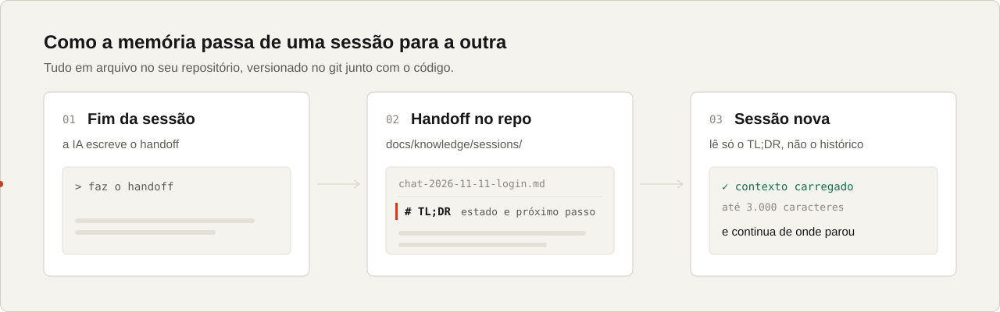
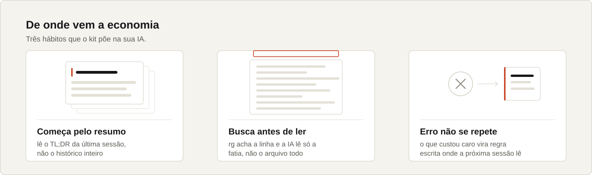

<picture>
  <source media="(prefers-color-scheme: dark)" srcset="assets/hero-escuro.svg">
  
</picture>

<p align="center">
  <a href="#install">Install</a> ·
  <a href="#how-it-works">How it works</a> ·
  <a href="#commands">Commands</a> ·
  <a href="#included-skills">Skills</a> ·
  <a href="README.md">Português</a>
  <br><br>
  <a href="LICENSE"></a>
  
  
</p>

Every new AI session starts from scratch. You explain the project again, paste what was left pending, and the
AI rereads whole files to find one line. kit-memoria-ia fixes that with plain markdown inside your repository:
the last session leaves a summary, and the next one reads only that summary and carries on.

It works with **Claude Code, Codex, Gemini CLI, Cursor and GitHub Copilot**, and with any other AI that reads
`AGENTS.md` or skills in the `SKILL.md` format.

> The kit itself (skills, templates, notes) is written in Brazilian Portuguese. Every AI listed above reads it
> fine and answers in your language.

## Install

You need [Node 22 or newer](https://nodejs.org). Nothing else.

**1. Once per computer**

```sh
git clone https://github.com/adeiltonpessini/kit-memoria-ia
node kit-memoria-ia/kit.mjs instalar
```

The installer looks for the AIs you have and installs into each one. The ones you don't have are left alone.

**2. In each project, from its folder**

```sh
node "$HOME/.kit-memoria-ia/kit.mjs" iniciar
```

Done. Open your AI and ask:

> read AGENTS.md and continue where you left off

In Claude Code you don't even need that: the hooks load the summary on their own.

## How it works

<picture>
  <source media="(prefers-color-scheme: dark)" srcset="assets/fluxo-escuro.svg">
  
</picture>

At the end of the work, the AI writes a handoff to `docs/knowledge/sessions/`. Its first section is a TL;DR with
the state and the next step. The next session reads only that part (up to 3,000 characters), not the history.

<picture>
  <source media="(prefers-color-scheme: dark)" srcset="assets/habitos-escuro.svg">
  
</picture>

A decision that isn't obvious goes to `docs/knowledge/decisions/`. A mistake that cost a lot becomes a lesson in
`docs/knowledge/licoes/`. Everything is a file versioned in git next to the code: you read, edit and delete it
like any other.

## What each AI gets

| | Claude Code | Codex · Gemini CLI | Cursor · Copilot · others |
|---|:---:|:---:|:---:|
| Memory rules in the project's `AGENTS.md` | ✓ | ✓ | ✓ |
| 13 skills in `SKILL.md` format | ✓ | ✓ | ✓ |
| Global rules in your user folder | | ✓ | |
| Automatic hooks (load the TL;DR, ask for the handoff, run the checks) | ✓ | | |
| Status line with context and quota | ✓ | | |

AIs without hooks get the rule in `AGENTS.md` and follow it when they read the file. In Claude Code, the hook
enforces it.

## Commands

| Command | What it does |
|---|---|
| `kit.mjs instalar` | installs into your user (once) |
| `kit.mjs iniciar` | turns memory on for the project in the current folder; running it again duplicates nothing |
| `kit.mjs lembrar "<topic>" --type session` | creates a handoff (also `decision`, `licao`, `misc`) |
| `kit.mjs buscar "<topic>"` | ranked search over the project notes |
| `kit.mjs diagnostico` | shows what is installed and what is missing |
| `kit.mjs remover` | removes the kit from your user; project notes stay |

After installing, run from any folder with `node "$HOME/.kit-memoria-ia/kit.mjs" <command>` (bash and PowerShell).

## Included skills

| Skill | For |
|---|---|
| `remember` | records a decision, handoff or note using the right template |
| `busca-eficiente` | `rg` and reading the smallest slice before opening a whole file |
| `licao-aprendida` | turns a costly mistake into a rule where the next session will read it |
| `verify` | runs the area's checks before saying "done" |
| `veracidade-de-numero` | traces a number or metric back to its source before publishing |
| `spec-primeiro` | a short spec before a feature that is expensive to redo |
| `grilling` | stress-tests a plan with questions and recommended answers |
| `pr` | PR body with a diagram, evidence and merge risk |
| `wizard` | a guided script for the step only you can do (dashboard, 2FA, secret) |
| `docs-context7` | pulls current library docs instead of guessing the API |
| `graphify` | AST map of the code: "what breaks if I change X?" |
| `sem-cara-de-ia` | reviews text so it doesn't sound like a robot |
| `skill-smith` | creates a new skill or agent the right way |

Plus two agents for Claude Code: `Explore` (read-only search on a cheap model) and `docs-researcher` (library
docs in an isolated context).

<details>
<summary><b>Optional</b></summary>
<br>

- **[ripgrep](https://github.com/BurntSushi/ripgrep)** (`rg`): recommended. Without it, search costs more.
- **[graphify](https://github.com/safishamsi/graphify)**: code graph for structure questions.
- **[ai-memory](https://github.com/akitaonrails/ai-memory)**, by Fabio Akita: captures sessions on its own.
  `tools/knowledge/aimemory.mjs` brings what it saved into `docs/knowledge/sessions/auto/`.
- **Automatic checks** (Claude Code): copy `verifica.exemplo.json` to `<project>/.claude/verifica.json` and say
  which command runs in which folder. The hook runs the checks for the area that changed before the AI stops.
- **Git guard** (Claude Code): `node kit.mjs instalar --com-guard-git` blocks `reset --hard`, `push --force` and
  the like.

Each hook has a variable to turn it off (`CLAUDE_VERIFICA=0`, `CLAUDE_LEMBRETE_CLEAR=0`, `CLAUDE_CORRECAO=0`,
`CLAUDE_DESPACHO=0`). A project without `docs/knowledge/` gets nothing: the hooks stay quiet.

</details>

<details>
<summary><b>FAQ</b></summary>
<br>

**Does it send anything to the internet?** No. Everything runs on your computer and writes files to your
repository. See [SECURITY.md](SECURITY.md).

**Do I need every AI?** No. The installer only touches the ones you have.

**How do I uninstall?** `node "$HOME/.kit-memoria-ia/kit.mjs" remover`. Project notes stay where they are.

**Why not RAG with embeddings?** At the size of a project, `rg` over markdown finds what matters, needs no
database or service, and you see exactly what the AI read.

</details>

## Further reading

- [GUIA.md](GUIA.md): the full method, the reason behind each rule and a prompt to set up a project from scratch.
- [INSTALAR.md](INSTALAR.md): reference for the Claude Code part (each hook, each script).
- [SECURITY.md](SECURITY.md): what the kit reads, what it writes and what it never touches.

## License and authorship

Copyright 2026 [Adeilton Pessini](https://github.com/adeiltonpessini). Released under the
[Apache License 2.0](LICENSE): free to use, commercially too, as long as you keep the [NOTICE](NOTICE) and the
authorship notices. The project name may not be used to endorse derived work; see [MARCA.md](MARCA.md).
Third-party parts and credits are listed in the NOTICE, each under its own license.

**Credits:** [Matt Pocock](https://github.com/mattpocock/skills) (grilling, pr, wizard, git guard),
[Safi Shamsi](https://github.com/safishamsi/graphify) (graphify), [Dex Horthy / HumanLayer](https://github.com/humanlayer/skills)
(pr summary) and [Fabio Akita](https://akitaonrails.com) ([ai-memory](https://github.com/akitaonrails/ai-memory)), who inspired
markdown memory without RAG.

To cite: [CITATION.cff](CITATION.cff). To contribute: [CONTRIBUTING.md](CONTRIBUTING.md).

<sub>Claude, Codex, Gemini, Cursor and GitHub Copilot are trademarks of their owners. This project is not
affiliated with them. The images in <code>assets/</code> come from <code>node tools/assets/gerar-imagens.mjs</code>.</sub>
