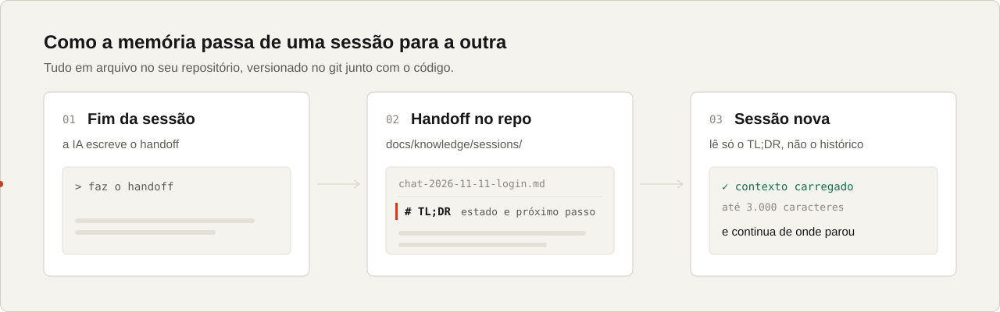
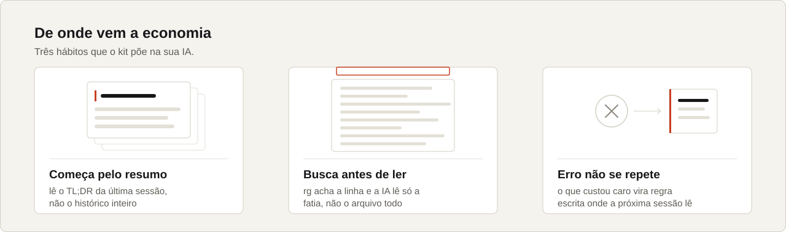

<picture>
  <source media="(prefers-color-scheme: dark)" srcset="assets/hero-escuro.svg">
  
</picture>

<p align="center">
  <a href="#instalar">Instalar</a> ·
  <a href="#como-funciona">Como funciona</a> ·
  <a href="#comandos">Comandos</a> ·
  <a href="#skills-incluídas">Skills</a> ·
  <a href="GUIA.md">Guia completo</a> ·
  <a href="README.en.md">English</a>
  <br><br>
  <a href="LICENSE"></a>
  
  
</p>

Toda sessão nova de IA começa do zero: você explica o projeto de novo, cola o que ficou pendente, e a IA relê
arquivo inteiro para achar uma linha. O kit-memoria-ia resolve isso com markdown simples dentro do seu
repositório. A sessão anterior deixa um resumo, a próxima lê só o resumo e continua.

Funciona com **Claude Code, Codex, Gemini CLI, Cursor e GitHub Copilot**, e com qualquer outra IA que leia
`AGENTS.md` ou skills no formato `SKILL.md`.

## Instalar

Você precisa do [Node 22 ou mais novo](https://nodejs.org). Nada mais.

**1. Uma vez por computador**

```sh
git clone https://github.com/adeiltonpessini/kit-memoria-ia
node kit-memoria-ia/kit.mjs instalar
```

O instalador procura as IAs que você tem e instala em cada uma. As que você não tem ficam intocadas.

**2. Em cada projeto, dentro da pasta dele**

```sh
node "$HOME/.kit-memoria-ia/kit.mjs" iniciar
```

Pronto. Abra a sua IA e peça:

> leia o AGENTS.md e continue de onde parou

No Claude Code nem isso é preciso: os hooks carregam o resumo sozinhos.

## Como funciona

<picture>
  <source media="(prefers-color-scheme: dark)" srcset="assets/fluxo-escuro.svg">
  
</picture>

No fim do trabalho, a IA escreve um handoff em `docs/knowledge/sessions/`. A primeira seção é um TL;DR com o
estado e o próximo passo. A sessão seguinte lê só essa parte (até 3.000 caracteres), não o histórico.

<picture>
  <source media="(prefers-color-scheme: dark)" srcset="assets/habitos-escuro.svg">
  
</picture>

Decisão que não é óbvia vai para `docs/knowledge/decisions/`. Erro que custou caro vira lição em
`docs/knowledge/licoes/`. Tudo é arquivo versionado no git junto com o código: você lê, edita e apaga como
qualquer outro.

## O que cada IA recebe

| | Claude Code | Codex · Gemini CLI | Cursor · Copilot · outras |
|---|:---:|:---:|:---:|
| Regras de memória no `AGENTS.md` do projeto | ✓ | ✓ | ✓ |
| 13 skills no formato `SKILL.md` | ✓ | ✓ | ✓ |
| Regras globais no seu usuário | | ✓ | |
| Hooks automáticos (carrega o TL;DR, cobra o handoff, roda a checagem) | ✓ | | |
| Linha de status com contexto e cota | ✓ | | |

Nas IAs sem hooks, a regra fica no `AGENTS.md` e a IA a segue quando lê o arquivo. No Claude Code, o hook garante.

## Comandos

| Comando | O que faz |
|---|---|
| `kit.mjs instalar` | instala no seu usuário (uma vez) |
| `kit.mjs iniciar` | liga a memória no projeto da pasta atual; rodar de novo não duplica nada |
| `kit.mjs lembrar "<tema>" --type session` | cria um handoff (também `decision`, `licao`, `misc`) |
| `kit.mjs buscar "<tema>"` | busca ranqueada nas notas do projeto |
| `kit.mjs diagnostico` | mostra o que está instalado e o que falta |
| `kit.mjs remover` | tira o kit do seu usuário; as notas dos projetos ficam |

Depois de instalar, rode de qualquer pasta com `node "$HOME/.kit-memoria-ia/kit.mjs" <comando>` (bash e PowerShell).

## Skills incluídas

| Skill | Para quê |
|---|---|
| `remember` | grava decisão, handoff ou nota no modelo certo |
| `busca-eficiente` | `rg` e leitura da fatia mínima antes de abrir arquivo inteiro |
| `licao-aprendida` | transforma erro caro em regra onde a próxima sessão lê |
| `verify` | roda a checagem da área antes de dizer "pronto" |
| `veracidade-de-numero` | rastreia número e métrica até a fonte antes de publicar |
| `spec-primeiro` | spec curta antes de feature cara de refazer |
| `grilling` | sabatina um plano com perguntas e respostas recomendadas |
| `pr` | corpo de PR com diagrama, evidência e risco de merge |
| `wizard` | script guiado para o passo que só você pode fazer (painel, 2FA, segredo) |
| `docs-context7` | puxa a doc atual da biblioteca em vez de chutar a API |
| `graphify` | mapa do código por AST: "o que quebra se eu mudar X?" |
| `sem-cara-de-ia` | revisa texto para não soar como robô |
| `skill-smith` | cria skill ou agente novo no padrão certo |

E dois agentes para o Claude Code: `Explore` (busca só de leitura, em modelo barato) e `docs-researcher`
(doc de biblioteca em contexto isolado).

<details>
<summary><b>Opcionais</b></summary>
<br>

- **[ripgrep](https://github.com/BurntSushi/ripgrep)** (`rg`): recomendado. Sem ele a busca gasta mais.
- **[graphify](https://github.com/safishamsi/graphify)**: grafo do código para perguntas de estrutura.
- **[ai-memory](https://github.com/akitaonrails/ai-memory)**, de Fabio Akita: captura a sessão sozinho. O
  `tools/knowledge/aimemory.mjs` traz o que ele gravou para `docs/knowledge/sessions/auto/`.
- **Checagem automática** (Claude Code): copie `verifica.exemplo.json` para `<projeto>/.claude/verifica.json` e
  diga qual comando roda em qual pasta. O hook roda a checagem da área que mudou antes de a IA encerrar.
- **Guarda do git** (Claude Code): `node kit.mjs instalar --com-guard-git` bloqueia `reset --hard`,
  `push --force` e parecidos.

Cada hook tem uma variável para desligar (`CLAUDE_VERIFICA=0`, `CLAUDE_LEMBRETE_CLEAR=0`, `CLAUDE_CORRECAO=0`,
`CLAUDE_DESPACHO=0`). Projeto sem `docs/knowledge/` não recebe nada: os hooks ficam calados.

</details>

<details>
<summary><b>Perguntas comuns</b></summary>
<br>

**Manda alguma coisa para a internet?** Não. Tudo roda no seu computador e grava arquivo no seu repositório.
Veja o [SECURITY.md](SECURITY.md).

**Preciso usar todas as IAs?** Não. O instalador só mexe nas que você tem.

**Como desinstalo?** `node "$HOME/.kit-memoria-ia/kit.mjs" remover`. As notas dos projetos continuam lá.

**Por que não RAG com embeddings?** No tamanho de um projeto, `rg` em markdown acha o que importa, não precisa
de banco nem de serviço, e você enxerga exatamente o que a IA leu.

</details>

## Mais leitura

- [GUIA.md](GUIA.md): o método completo, o porquê de cada regra e um prompt para configurar um projeto do zero.
- [INSTALAR.md](INSTALAR.md): referência da parte do Claude Code (cada hook, cada script).
- [SECURITY.md](SECURITY.md): o que o kit lê, o que grava e o que nunca toca.

## Licença e autoria

Copyright 2026 [Adeilton Pessini](https://github.com/adeiltonpessini). Distribuído sob a
[Apache License 2.0](LICENSE): uso livre, inclusive comercial, desde que você mantenha o [NOTICE](NOTICE) e os
avisos de autoria. O nome do projeto não pode ser usado para endossar trabalho derivado; veja [MARCA.md](MARCA.md).
Partes de terceiros estão listadas no NOTICE, cada uma com a sua licença.

**Créditos:** [Matt Pocock](https://github.com/mattpocock/skills) (grilling, pr, wizard, guarda do git),
[Safi Shamsi](https://github.com/safishamsi/graphify) (graphify), [Dex Horthy / HumanLayer](https://github.com/humanlayer/skills)
(resumo do pr) e [Fabio Akita](https://akitaonrails.com) ([ai-memory](https://github.com/akitaonrails/ai-memory)), que inspirou a
memória em markdown sem RAG.

Para citar: [CITATION.cff](CITATION.cff). Para contribuir: [CONTRIBUTING.md](CONTRIBUTING.md).

<sub>Claude, Codex, Gemini, Cursor e GitHub Copilot são marcas de seus donos. Este projeto não tem vínculo com
eles. As imagens em <code>assets/</code> saem de <code>node tools/assets/gerar-imagens.mjs</code>.</sub>
